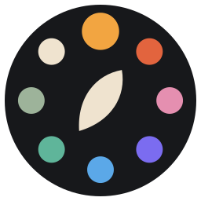

<p align="center"></p>

# IKriate

IKriate is a digital painting application for Windows, Linux and Android tablets, built on
[Krita](https://krita.org) 5.3. It keeps Krita's painting engine, brushes, file formats and
colour management, and adds an interface you can switch to suit the device in front of you.

> IKriate is an independent project. It is not made, endorsed or supported by the Krita
> Foundation or KDE. Please report IKriate problems here, not to Krita's bug tracker.

## What IKriate adds

| | |
|---|---|
| **Three interface layouts** | *Classic* (Krita's docked layout, default on computers), *Minimal* (full canvas, slim top bar and side bar) and *Radial* (touch-first, default on Android tablets). Every layout is available on every build: **Settings › Interface Layout**. |
| **Radial palette on touch** | In Radial, hold one finger on the canvas for the radial palette. Two-finger tap undoes, three-finger tap redoes, four-finger tap hides the interface. |
| **Brush Studio** | One sheet to browse tagged brush sets, search, pick a brush and set size, opacity, flow and smoothing (**Tools › Brush Studio**, `Ctrl+Alt+B`). |
| **Skins and tinting** | Four bundled skins (Charcoal, Paper, Midnight, High Contrast), all of Krita's themes, your own skins, a custom accent colour and a tint with adjustable strength (**Settings › Interface & Skins**). |
| **Side-by-side with Krita** | IKriate keeps its own settings (`ikriaterc`) and resource folder (`ikriate`), so it can be installed next to Krita without either touching the other's data. |

## Custom skins

A skin is a KDE colour scheme file with an optional `[IKriate]` section, saved as `.ikskin`
(any `.colors` file also works). Start by copying a bundled skin from
`krita/data/ikriate/skins/` into your skins folder (**Interface & Skins › Open Folder**):

```ini
[IKriate]
Accent=242,165,65        ; selection and active-control colour
ChromeRadius=14          ; corner radius of floating panels, px
PanelOpacity=240         ; 120-255, opacity of panels over the canvas
Stylesheet=my-skin.qss   ; optional Qt stylesheet next to the skin
Description=One line shown in the skin picker
```

## Building

See [packaging/README-IKRIATE.md](packaging/README-IKRIATE.md) for Linux, Windows and Android
builds, both locally and on GitHub Actions.

## Licence

IKriate is free software under the GNU General Public License v3 (see `COPYING` and
`LICENSES/`), like the Krita code it is based on. Krita's original README is kept in
[README.krita.md](README.krita.md).
